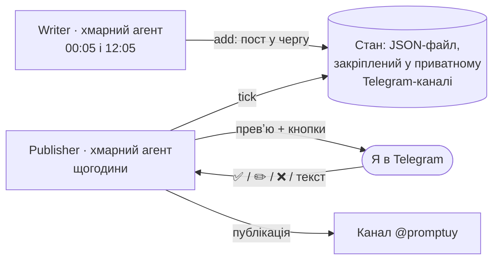

# Промптуй · автопостинг Telegram-каналу на AI-агентах

Telegram-канал [@promptuy](https://t.me/promptuy) про практичний ШІ, який веде себе сам.
Двічі на день хмарний AI-агент шукає, що зараз обговорюють реальні люди (Reddit, Hacker News, GitHub, TikTok, Product Hunt),
пише пост українською і ставить у чергу. Я отримую превʼю в особистих з кнопками і можу
опублікувати, відредагувати або скасувати. Якщо нічого не натиснув, пост виходить сам приблизно за годину.

Без сервера, без бази даних, без увімкненого ноутбука. Зроблено за кілька вечорів у вайбкодингу з Claude Code.

## Як це працює



1. **Writer** ([routines/writer.md](routines/writer.md)) досліджує тренди за останні 1–7 днів (мінімум 12 джерел, половина з них спільноти й автори, а не пресрелізи компаній),
   пише один пост за правилами каналу і ставить його в чергу на випадковий час: 08:00–11:30 або 15:00–20:30, щоб пости не виходили щодня в одну хвилину.
   Опівдні ще надсилає мені приватний бриф «Тренди та ніші».
2. **Publisher** ([routines/publisher.md](routines/publisher.md)) щогодини запускає `promptuy.py tick`:
   - коли настав час, надсилає мені превʼю з кнопками **✅ Публікуй зараз / ✏️ Редагувати / ❌ Скасувати**;
   - якщо реакції немає ~55 хв, публікує пост сам;
   - **✏️** → бот питає «Що не так з постом?» → агент переписує пост за моїм відгуком, зберігає загальний урок і знову показує превʼю. Якщо я не відповів, виходить оригінал;
   - будь-яке інше моє повідомлення боту зберігається як побажання на майбутнє.
3. **Пости з відео**: кидаю боту `/post` і посилання на TikTok / YouTube Shorts / Reels (можна кілька за раз).
   На найближчому запуску publisher розбирає кожне відео (yt-dlp, oEmbed, кадри через ffmpeg, пошук) і робить **фактчек**:
   виписує твердження з відео, звіряє кожне з першоджерелом (офіційний сайт, документація, GitHub, ціни) і ставить вердикт
   ✅ правда / ⚠️ частково / ❌ неправда. Вердикт я бачу над превʼю. ❌ поста не буде, бот просто пояснить чому.
   Решту пише за підтвердженими фактами і розкладає з інтервалом 2–3 год (09:00–21:30).
4. **Навчання на фідбеку**: уроки (`lessons`) лежать у стані, і writer читає їх перед кожним постом. Так канал поступово підлаштовується під мій смак без зміни коду.

### Життєвий цикл поста

```
queued → notified → published
              │  ├─ ✅ → approved → published
              │  ├─ ❌ → cancelled
              │  └─ ✏️ → edit_requested → feedback_asked ─┬─ відповідь → rewrite_needed → (агент переписує) → queued
              │                                           └─ тиша ~1 год → published
```

## Інженерні рішення

| Задача | Рішення | Чому |
|---|---|---|
| Працювати без увімкненого Mac | Claude Code cloud routines за cron | Нуль інфраструктури, не треба VPS |
| Де зберігати стан між запусками | JSON-документ, закріплений у приватному Telegram-каналі | Хмарні запуски не мають спільного диска, а бот уже має доступ до Telegram. Ніяких зовнішніх БД і нових секретів |
| Кнопки без вебхука | `getUpdates` з офсетом при кожному `tick` | Не треба публічного сервера. Ціна: реакція на кнопку до 1 год |
| Доставка коду в хмару | Рутини клонують цей репозиторій як джерело; `git push` оновлює бота | Спершу код завантажувався з Telegram, і класифікатор безпеки хмарного агента слушно заблокував «завантаж і запусти код з чату». Потім скрипт вбудовувався в промпт з перевіркою sha256, а тепер він приходить з репо, як у звичайному CI |
| Відкладені пости | Свій розклад у стані, публікація на найближчому запуску | Bot API не вміє нативні відкладені повідомлення Telegram |
| Форматування | Telegram HTML: жирний, курсив, цитати, `<blockquote expandable>` для детальних інструкцій | Пост короткий на вигляд, а повна інструкція відкривається по тапу |
| Секрети | Тільки змінні середовища (`TG_BOT_TOKEN`, `TG_CHAT_ID`) | У репозиторії й промптах немає токенів |
| Якість текстів | Окремі правила каналу + уроки з фідбеку + заборона вигадувати факти, кожен факт з URL | Аудиторія широка й нетехнічна, довіра важливіша за кількість постів |

Правила текстів лежать в [routines/post-rules.md](routines/post-rules.md), і обидва агенти читають їх перед кожним постом.

## Запуск локально

```bash
cp .env.example .env    # впиши свій токен бота і chat id
set -a && . ./.env && set +a
PROMPTUY_CHANNEL=@your_test_channel python3 promptuy.py init   # один раз: створює стан
python3 promptuy.py add --file post.html --window now
python3 promptuy.py tick
python3 promptuy.py status
```

Потрібен лише Python 3.9+ (стандартна бібліотека, без залежностей). Бот має бути адміном каналу публікацій
і приватного каналу для стану (`STORE` у скрипті).

Команди: `tick` · `add --file F [--window morning|evening|now]` · `set-text ID --file F` · `video-done ID --file F --check C` · `video-reject ID --check C` · `video-fail ID REASON` · `setup-commands` · `lesson TEXT` · `lessons` · `status` · `dm --file F` · `init`.
Для тестів час можна підмінити через `PROMPTUY_NOW`.

## Що б я покращив далі
- Вебхук на маленькому сервері, щоб кнопки і `/post` реагували миттєво, а не до години.
- Тести на машину станів `tick` з фейковим Telegram API.
- Статистика переглядів і реакцій, щоб writer бачив, які теми заходять.

## Стек
Python (stdlib) · Telegram Bot API · Claude Code cloud routines · промпт-інженерія агентів.
